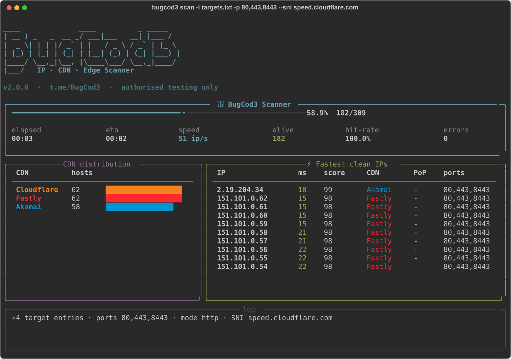
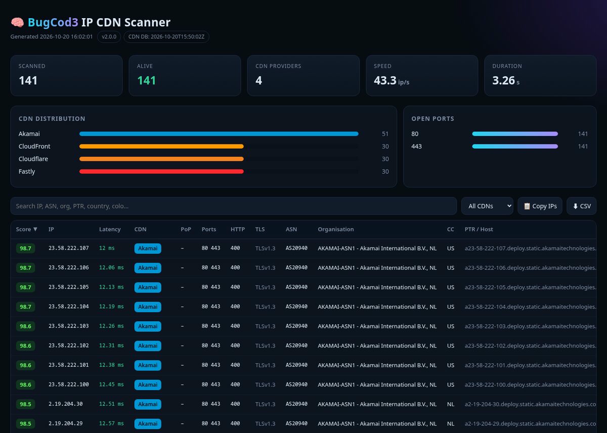

<p align="center">
  
</p>

<p align="center">
  <b>Fast async CDN &amp; edge-IP intelligence scanner.</b><br>
  Find clean, low-latency CDN IPs, fingerprint the CDN behind any host, and get real ASN, PoP and TLS data in one run.
</p>

<p align="center">
  <a href="https://github.com/MRvirusIR/BugCod3-IP-CDN-Scanner/actions"></a>
  
  
  
  
  <a href="https://t.me/BugCod3"></a>
</p>

<p align="center">
  <a href="#-quick-start">Quick start</a> ·
  <a href="#-features">Features</a> ·
  <a href="#-usage">Usage</a> ·
  <a href="#-recipes">Recipes</a> ·
  <a href="#-output">Output</a> ·
  <a href="#-how-it-works">How it works</a> ·
  <a href="#-راهنمای-فارسی">فارسی</a>
</p>

<p align="center">
  
</p>

---

## ⚡ Quick start

```bash
git clone https://github.com/MRvirusIR/BugCod3-IP-CDN-Scanner.git
cd BugCod3-IP-CDN-Scanner
pip install .            # installs the `bugcod3` command

bugcod3 update           # optional: pull the latest official CDN ranges
bugcod3 scan -i data/targets.txt
```

Prefer not to install it? `pip install -r requirements.txt && python3 main.py -i data/targets.txt` works too.

---

## ✨ Features

| | |
|---|---|
| 🚀 **Streaming async engine** | A producer feeds a bounded queue, so memory stays flat even on a `/8`. Ports are probed concurrently, and there's a token-bucket `--rate` limit. |
| 🎯 **Accurate CDN detection** | Three layers: **official IP ranges** (longest-prefix match, O(1)), then **HTTP header fingerprints** (`cf-ray`, `x-amz-cf-id`, `x-served-by`…), then **ASN**. |
| 🌍 **15+ providers** | Cloudflare, CloudFront, Fastly, Akamai, Google, Gcore, BunnyCDN, ArvanCloud, Imperva, Sucuri, Vercel, Netlify, CDN77, Edgio, Azure Front Door. |
| 🔄 **Self-updating ranges** | `bugcod3 update` pulls the lists each provider publishes (Cloudflare, AWS, Fastly, Google, Gcore, Bunny, Arvan). |
| 🔐 **Real TLS verification** | Handshakes with your **SNI**, verifies the certificate, and records the TLS version, cipher, ALPN, issuer and expiry. |
| 🌐 **Real HTTP check** | Sends an actual request with a custom `Host`. On Cloudflare it reads `/cdn-cgi/trace` to get the **PoP / colo** (e.g. `FRA`, `IST`). |
| 📶 **Latency quality** | `--rounds N` measures median latency, **jitter** and **packet loss**, and every IP gets a **0–100 score** for ranking clean IPs. |
| 🧠 **Real ASN intel** | ASN, prefix, country and organisation via Team Cymru DNS. Lookups are async and cached per /24. Reverse DNS (PTR) is included. |
| 🧩 **Flexible input** | IPs, IPv6, CIDRs, `1.1.1.1-50` ranges, domains, URLs and `host:port`, from args, files or **stdin**. |
| 🎲 **Huge-range mapping** | `--sample N` scans N random IPs per /24, so you can map all of Cloudflare in minutes. |
| 💾 **Never lose work** | Results stream to `results.jsonl` as they're found. Ctrl+C saves partial reports, and `--resume` continues. |
| 📊 **Beautiful reports** | Interactive HTML (search, filter, sort, copy IPs, CSV export), plus JSON, CSV and plain `clean_ips.txt`. |
| 🛡 **Safe by design** | HTML is autoescaped and CSP-locked (PTR records are attacker-controlled!). CSV formula injection is neutralised and bogon ranges are always excluded. |

---

## 🛠 Usage

```text
bugcod3 scan    [targets...] [-i FILE] [options]   scan targets (default command)
bugcod3 lookup  IP|DOMAIN ...                      identify CDN / ASN without scanning
bugcod3 ranges  [PROVIDER] [--v6]                  list providers or print a provider's CIDRs
bugcod3 update                                     refresh CDN ranges from official sources
```

<details open>
<summary><b>Scan options</b></summary>

| Option | Default | Description |
|---|---|---|
| `-i, --input FILE` | – | Targets file, repeatable. `-` reads stdin |
| `-p, --ports` | `web` | `80,443`, ranges `8000-8100`, or presets: `web` `cf` `cf-tls` `cf-http` `alt` |
| `-m, --mode` | `http` | `tcp` connect only · `tls` adds the handshake · `http` adds a real request and fingerprint |
| `-w, --workers` | `300` | Concurrent hosts |
| `-r, --rate` | `0` | Max new connections per second (0 = unlimited) |
| `-t, --timeout` | `3` | Per-connection timeout (s) |
| `--retries` | `1` | Retries on **timeout only** (refused ports aren't retried) |
| `--rounds` | `1` | Latency samples per port → jitter and loss |
| `--sni` / `--host` | – | TLS SNI and HTTP `Host` header (e.g. your domain behind the CDN) |
| `--path` | `/` | HTTP path to request |
| `--insecure` | off | Skip certificate verification |
| `--no-trace` | off | Don't query `/cdn-cgi/trace` |
| `--sample N` | `0` | Only N random IPs per /24 |
| `--shuffle` | off | Randomise target order |
| `--exclude` | – | CIDR, IP or file to never scan (repeatable) |
| `--only-cdn` | – | Scan only IPs inside these CDNs' ranges (`cloudflare,fastly`) |
| `--cdn-only` | off | Drop results that aren't behind a CDN |
| `--max-latency MS` | – | Drop slow results |
| `--no-enrich` / `--no-ptr` | off | Skip ASN+PTR / PTR lookups for extra speed |
| `--resolvers` | system | DNS servers, e.g. `1.1.1.1,8.8.8.8` |
| `-o, --output DIR` | `results` | Output directory |
| `-f, --format` | all | `json,csv,txt,html` |
| `--resume` | off | Append to `results.jsonl` and skip IPs already found |
| `--no-ui` / `--silent` | off | Plain log, or alive IPs only on stdout (pipe friendly) |

</details>

---

## 🍳 Recipes

**Find the fastest clean Cloudflare IPs for your domain**
```bash
bugcod3 ranges cloudflare | bugcod3 scan -i - --sample 2 -p cf-tls \
        --sni your.domain.com --rounds 3 --max-latency 200
```

**Check which CDN a list of domains sits behind**
```bash
bugcod3 lookup github.com cloudflare.com netflix.com
bugcod3 scan -i domains.txt -p 443 --cdn-only
```

**Pipe-friendly output, only IPs under 150 ms**
```bash
bugcod3 scan -i ranges.txt --max-latency 150 --silent > clean.txt
```

**Gentle scan (rate limited, TCP only, no enrichment)**
```bash
bugcod3 scan 203.0.113.0/24 -m tcp -r 200 --no-enrich
```

**Long scan you can interrupt and continue**
```bash
bugcod3 scan -i big.txt -o run1            # Ctrl+C any time…
bugcod3 scan -i big.txt -o run1 --resume   # …and pick up where you left off
```

---

## 📦 Output

Each run writes to `results/` (change it with `-o`):

| File | Contents |
|---|---|
| `results.jsonl` | One JSON object per alive host, **written live** |
| `report.html` | Interactive dark-theme report: search, CDN filter, sortable columns, copy IPs, CSV export |
| `report.json` | Full results plus scan metadata |
| `report.csv` | Flat table for Excel / Sheets |
| `clean_ips.txt` / `clean_ip_ports.txt` | Sorted by score, ready for other tools |

<p align="center"></p>

<details>
<summary><b>Example JSON result</b></summary>

```json
{
  "ip": "104.16.123.10",
  "cdn": "Cloudflare",
  "cdn_method": "range",
  "colo": "FRA",
  "latency": 18.4,
  "score": 97.6,
  "asn": { "asn": 13335, "prefix": "104.16.0.0/13", "country": "US", "org": "CLOUDFLARENET - Cloudflare, Inc., US" },
  "open_ports": [80, 443],
  "ports": [
    { "port": 443, "scheme": "https", "latency": 18.4, "jitter": 0.9, "loss": 0.0,
      "tls": true, "tls_version": "TLSv1.3", "tls_verified": true, "status": 200,
      "server": "cloudflare", "trace": { "colo": "FRA", "loc": "DE", "http": "http/1.1", "tls": "TLSv1.3" } }
  ]
}
```
</details>

---

## 🧠 How it works

```text
 targets ─► parser ─► async DNS ─► streaming expander ─► bounded queue ─► N workers
 (ip/cidr/range/      (A/AAAA)     (--sample, --exclude,                    │
  domain/url/stdin)                 --only-cdn pre-filter)                  ▼
                                                         ports probed concurrently
                                              TCP ─► TLS+SNI (verify) ─► HTTP / cdn-cgi/trace
                                                                            │
                     CDN: ranges ─► headers ─► ASN    ◄── enrich: ASN (Cymru) + PTR, cached
                                                                            │
                                   sinks: results.jsonl · dashboard · --silent stdout
                                                                            ▼
                                                  report.html · json · csv · clean_ips.txt
```

```text
bugcod3/
├── cli.py        # argparse CLI: scan / lookup / ranges / update
├── engine.py     # producer → queue → workers, results model, scoring
├── probe.py      # TCP / TLS / HTTP probes, rate limiter
├── cdn.py        # prefix-table CDN DB + header fingerprints
├── resolver.py   # async DNS, PTR, Team Cymru ASN
├── targets.py    # input parsing, CIDR/range expansion, sampling
├── updater.py    # official CDN range fetchers
├── reports.py    # JSONL / JSON / CSV / TXT / HTML writers
├── ui.py         # Rich live dashboard
├── templates/report.html
└── data/cdn_ranges.json
```

**Score (0–100)** is `100 − (latency + 2·jitter + 400·loss + penalties) / 10`. Penalties apply to unhealthy ports and untrusted certificates. Higher is better.

---

## 🆕 What's new in v2

- Completely rewritten engine: streaming, concurrent ports, one connection per check, **no blocking DNS** (v1 froze the event loop on every PTR lookup)
- CDN database rebuilt from **official sources**. v1 mislabelled AWS CloudFront ranges as *Netlify* and Equinix ranges as *BunnyCDN*
- Real ASN, country and org (v1 always showed `N/A`)
- Real TLS verification with SNI. In v1, a failed handshake still counted as "alive"
- HTTP fingerprinting, Cloudflare PoP detection, jitter/loss and scoring
- Full CLI, stdin and pipes, `--silent`, sampling, exclusions, CDN filters, rate limiting
- Live JSONL, Ctrl+C safe, `--resume`
- **Security fix:** v1's HTML report was vulnerable to XSS via malicious PTR records
- `pip install .`, a `bugcod3` command, unit tests and GitHub Actions CI

---

## 🇮🇷 راهنمای فارسی

<div dir="rtl">

**BugCod3 IP CDN Scanner** ابزاریه برای پیدا کردن IPهای تمیز و کم‌پینگ CDN. با این ابزار می‌شه فهمید هر هاست پشت کدوم CDN قرار داره و اطلاعات ASN، دیتاسنتر (PoP) و TLS رو هم گرفت.

</div>

```bash
pip install .
bugcod3 update                                   # آپدیت رنج‌های رسمی CDN
bugcod3 scan -i data/targets.txt                 # اسکن فایل هدف‌ها
bugcod3 ranges cloudflare | bugcod3 scan -i - --sample 2 -p cf-tls --sni your.domain.com --rounds 3
bugcod3 lookup example.com 104.16.1.1            # تشخیص CDN بدون اسکن
```

<div dir="rtl">

- با `--sni` دامنه‌ی خودت رو بده تا TLS واقعی تست بشه
- با `--rounds 3` پینگ، jitter و loss دقیق‌تر اندازه گرفته می‌شن
- با `--sample 2` رنج‌های بزرگ خیلی سریع اسکن می‌شن (۲ IP از هر /24)
- با `--max-latency 150 --silent` فقط IPهای سریع چاپ می‌شن
- با Ctrl+C نتایج ذخیره می‌شن و با `--resume` اسکن از همون‌جا ادامه پیدا می‌کنه
- خروجی‌ها توی پوشه‌ی `results/` ذخیره می‌شن (HTML، JSON، CSV و `clean_ips.txt`)

</div>

---

## 🛡 Disclaimer

This tool is for **education, network research and authorised security testing** only. Only scan networks you own or have permission to test. Use `--rate` to stay polite. The author is not responsible for misuse.

## 🎨 Brand

| Icon | Banner |
|---|---|
|  |  |

Vector assets live in [`assets/`](assets). Feel free to use `logo.svg` as an avatar or a GitHub social preview.

## ⭐ Credits

Built with ❤️ by **BugCod3** · [t.me/BugCod3](https://t.me/BugCod3) · [t.me/RootAccessClub](https://t.me/RootAccessClub)

If this tool helped you, drop a ⭐ on the repo!